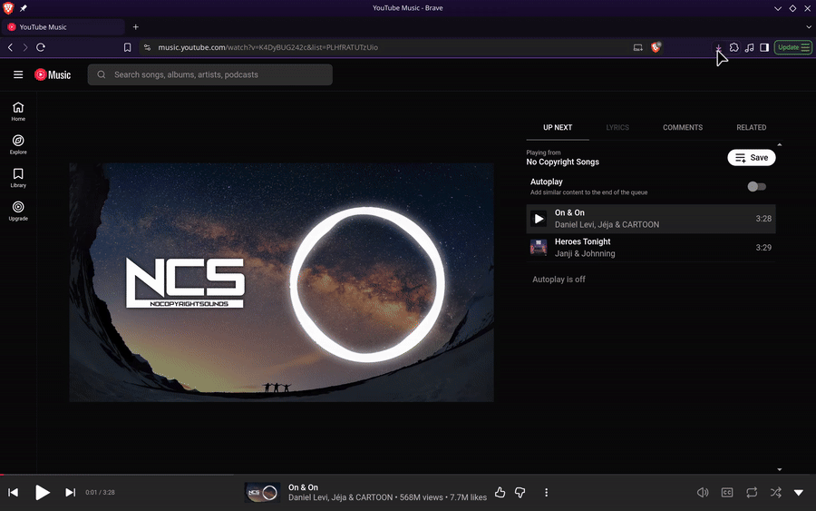
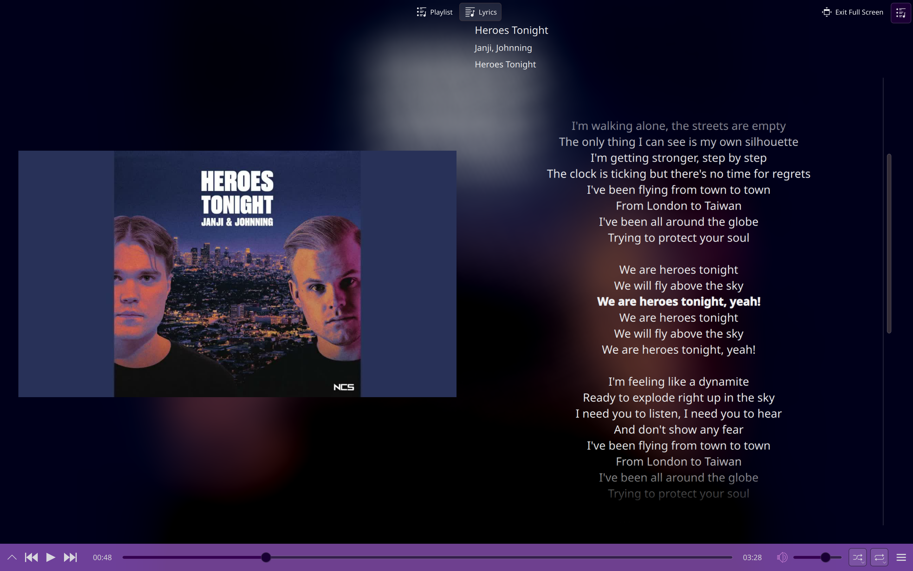

# ytdl-bridge

One-click yt-dlp frontend for Brave/Chrome — click the extension on a YouTube or YT Music page and yt-dlp downloads it in a terminal window, with live progress and a desktop notification when it finishes.




<sub>Sped up 2x. Demo tracks: Cartoon, Jéja – On & On (feat. Daniel Levi) and Janji – Heroes Tonight (feat. Johnning) [NCS Release]</sub>

- **One click** on any YouTube or YT Music page, or `Ctrl+Shift+Y`
- **Music comes out as tagged Opus** with clean artist and title, plus synced lyrics when available
- **Whole playlists and channels** download in batches, without the cookies going stale
- **Keeps running if you close the browser.** The terminal closes itself after a clean run and stays open only if something broke
- **One config file**, with an installer for Brave, Chrome, Chromium, Vivaldi and Edge

This is a frontend for [yt-dlp](https://github.com/yt-dlp/yt-dlp), not a replacement. It is a personal tool shared as-is: only download content you have the right to download, and respect the terms of the sites you use it on.

Audio mode (YT Music pages) rips to Opus with cleaned-up title and artist tags. Video mode (YouTube pages) merges to MKV with English subs embedded.

## Quick Start

Linux only, tested on Fedora KDE. You need Brave or Chrome, and to be signed in to YouTube in it.

**1. Install the dependencies**

| Distro | Command |
|---|---|
| Fedora | `sudo dnf install yt-dlp ffmpeg-free python3 libnotify` |
| Debian / Ubuntu | `sudo apt install yt-dlp ffmpeg python3 libnotify-bin` |
| Arch | `sudo pacman -S yt-dlp ffmpeg python libnotify` |

You also need one terminal emulator (konsole, gnome-terminal, xfce4-terminal or xterm). Most desktops already have one.

Optional, for lyrics in audio mode:

```bash
pip install --user mutagen syncedlyrics
```

**2. Get the code**

```bash
git clone https://github.com/AdyanshSahai/ytdl-bridge
cd ytdl-bridge
```

Keep this folder where it is. The extension and the host both run from it.

**3. Load the extension**

1. Open `brave://extensions` (or `chrome://extensions`)
2. Turn on **Developer mode** (top right)
3. Click **Load unpacked** and pick the `extension/` folder inside the repo

**4. Register the native host**

```bash
bash scripts/install.sh
```

It finds your browser (Brave, Chrome, Chromium, Vivaldi or Edge) and registers the host. There's no ID to copy: the extension has a fixed ID, so it works on any machine. Then **fully restart the browser**.

**5. Answer the setup questions**

At the end of `install.sh` you're asked three things: which browser holds your YouTube login (`brave` by default), and where audio and video should be saved (`~/Music` and `~/Videos` by default). Press Enter to accept a default. Your answers are saved to `config_local.ini` so updates never overwrite them, and only values that differ from the defaults are written. Everything else is in [config.ini](config.ini); see [Configuration](#configuration).

**6. Try it**

Open any video on youtube.com, click the extension icon, pick **Video**. A terminal should open and start downloading.

## How It Works

The extension hands the page to a small Python program on your machine, which runs yt-dlp in a terminal. Only this extension can talk to it, and no value from the page is ever run as a shell command. See [DESIGN.md](DESIGN.md) for the architecture, design decisions and security details.

## Using It

1. Open a YouTube or YT Music page.
2. Click the extension icon (or press `Ctrl+Shift+Y`) and pick **Audio** or **Video**. `music.youtube.com` is audio, `youtube.com` is video.
3. On a single video, the download starts immediately.
4. On a playlist or channel (`?list=` URLs, or `/@handle/videos`, `/channel/...`, `/c/...`, `/user/...`), choose where to save and how many items, then confirm.
5. A terminal opens and runs the job. A desktop notification fires when it finishes.

Right-click the icon for a quick Audio/Video download: full length, auto-named folder, no popups.

If the run is clean, the terminal closes itself. If anything goes wrong (yt-dlp exit code or `ERROR` line, lyrics failure, notification failure, nothing saved), it stays open so you can read it.

## Updating

```bash
cd ytdl-bridge
git pull
```

Then click the reload arrow on the extension at `brave://extensions`. You don't need to run the installer again, unless you moved the folder.

To keep yt-dlp itself current, run `bash scripts/update.sh`. It updates a pip install, and only if the installed version is outdated. If you installed yt-dlp with your package manager, update it with that instead.

## Uninstalling

```bash
bash scripts/uninstall.sh
```

This removes the host registration and the small run counter in `~/.local/state/ytdl-host`. Then remove the extension at `brave://extensions` and delete the cloned folder. Your downloads are not touched.

## Popup Options

Where to save:

| Option | Result |
|---|---|
| Default folder (flat) | everything in one folder, `yt-rips` unless you change `flat_folder` |
| Auto-named | a folder named after the playlist (or channel) |
| Custom folder name | whatever you type |

How many:

| Option | Result |
|---|---|
| Just this video | only the open video, ignoring the playlist it's in |
| Entire playlist | the whole thing, in batches |
| First X items | the first X, in batches |

On a bare playlist/channel page with nothing playing, "Just this video" is hidden and the default becomes the whole thing. On YT Music, where playing a song from a playlist page leaves the URL on `/playlist?list=...`, the popup reads the real playing video ID from the player.

## Configuration

Every setting lives in [config.ini](config.ini). To keep your own values, create `config_local.ini` next to it (gitignored) containing only the lines you want to change, for example:

```ini
[folders]
music_dir = /data/Music
video_dir = /data/Videos

[browser]
cookies_from = chrome
```

Changes apply on the next download, with no browser restart. A missing or unreadable value falls back to its default.

| Section | Key | Default | What it does |
|---|---|---|---|
| `folders` | `music_dir` | `~/Music` | where audio downloads go |
| `folders` | `video_dir` | `~/Videos` | where video downloads go |
| `folders` | `flat_folder` | `yt-rips` | name of the flat default folder inside each of the two above |
| `browser` | `cookies_from` | `brave` | browser yt-dlp reads your YouTube login from: `brave`, `chrome`, `chromium`, `edge`, `firefox`, `opera`, `vivaldi`, `BROWSER:PROFILE`, or `none` |
| `download` | `audio_format` | `bestaudio[abr=128]/bestaudio` | yt-dlp format selector for audio |
| `download` | `video_format` | `bestvideo+bestaudio/best` | yt-dlp format selector for video |
| `download` | `concurrent_fragments` | `16` | fragments yt-dlp downloads in parallel |
| `download` | `batch_size` | `10` | playlist items per yt-dlp run |
| `download` | `cache_wipe_every` | `10` | wipe yt-dlp's cache every N downloads |
| `lyrics` | `enabled` | `true` | fetch lyrics after each audio download |
| `sync` | `mount_point`, `phone_dir`, `delete` | `~/phone`, `Internal shared storage/Music`, `false` | optional phone sync, see [Phone Sync](#phone-sync-optional) |

The extension itself holds no paths: it tells the host *where* to save (flat, auto-named or custom) and the host builds the real folder from this file.

## Lyrics

In audio mode (and unless `enabled = false` in `config.ini`), `native/add_lyrics.py` fetches lyrics for each song as it finishes downloading and embeds them in the file, using [syncedlyrics](https://github.com/moehmeni/syncedlyrics). It runs from the same folder as `host.py`, so there is nothing to configure. If `mutagen` or `syncedlyrics` isn't installed, lyrics are skipped with a one-line note and the run still counts as clean. If the script runs and fails, the terminal stays open.



It also works on its own, for songs you already have:

```bash
python3 native/add_lyrics.py --music-dir ~/Music --whitelist yt-rips
```

`--music-dir` defaults to `$YTDL_MUSIC_DIR`, then `~/Music`. `--blacklist NAME` (repeatable) skips folders.

## Tools

`tools/clean_names.py` strips YouTube junk out of filenames and title tags for files that are already downloaded. It does a dry run unless you pass `--apply`:

```bash
python3 tools/clean_names.py ~/Music/yt-rips -r
```

It is not the same rule set as `host.py`. `host.py` only strips brackets that contain junk words like `(Official Video)` or `[4K]`, so `Song (Krono Remix)` keeps its remix tag. `clean_names.py` strips all bracketed text, so that file would become `Song`.

## Phone Sync (optional)

Copies `music_dir` to an Android phone over USB. Needs `jmtpfs` and `rsync` (for example `sudo dnf install jmtpfs rsync`). Plug the phone in, unlock it, set USB mode to **File transfer**, then right-click the extension icon and pick **Sync music to phone** (or use the small link in the popup, or run `bash scripts/sync.sh`).

It reads `music_dir` and the `[sync]` section of your config. `mount_point` and `phone_dir` say where the phone mounts and which folder on it to fill. `delete = false` by default, so files are only added and updated and nothing on the phone is removed. Set `delete = true` in `config_local.ini` to make the phone mirror your folder exactly, removing songs that are not in `music_dir`. Scripts, `.ini` files, hidden files, temp files and `Misc` folders are never copied.

## Known Issues

- `ERROR` lines print at the end of each batch with only a video ID, not inline at the failing item.
- The flat `yt-rips` folder is named by cleaned title only, so different songs with the same title (or a remaster and the original) can silently fail to save.
- The `Artist - Song` split is a guess; `Song - Live at X` gets the wrong artist.
- With an unknown playlist size, a batch that adds zero files ends the loop, so 10 private/repeat items in a row stops it early.
- No `trap` cleanup if the terminal is closed mid-run.
- Some playlist tracks are region-blocked and need a VPN.

## Troubleshooting

| Problem | Fix |
|---|---|
| Nothing happens when you click Download | The host isn't registered. Run `bash scripts/install.sh` again and fully restart the browser. |
| It worked, then stopped after you moved the folder | The registration remembers where `host.py` was. Re-run `bash scripts/install.sh` from the new location, and reload the extension from there. |
| "Sign in to confirm you're not a bot" or age-restricted errors | yt-dlp isn't getting your cookies. Check `cookies_from` in your config matches the browser you're logged in with, and that you're signed in to YouTube there. |
| Old or odd yt-dlp errors | Run `bash scripts/update.sh`, or update yt-dlp with your package manager. |
| Terminal stays open after a download | By design: something reported an error. Read the lines above the prompt. |
| No terminal opens | Install one of konsole, gnome-terminal, xfce4-terminal or xterm. |
| Using another browser (Opera, a Flatpak browser...) | The installer only knows Brave, Chrome, Chromium, Vivaldi and Edge. Copy `native/com.ytdlbridge.host.json` (created by the installer) into that browser's `NativeMessagingHosts` folder by hand. |

## Planned Updates

- Show errors inline with title and index instead of at the end of a batch.
- Avoid filename collisions in the flat folder.
- Share the channel regex between `popup.js`, `background.js` and `host.py` instead of duplicating it.
- Move the download logic from the generated bash script into a Python runner, so the same code works on every OS and no shell ever parses the URL.
- Windows support, built on that runner. The main unknown is cookies: Chrome on Windows encrypts them in a way yt-dlp often can't read, so Firefox or a cookies file may be needed there.

Feel free to contribute via forks and Pull Requests, or open an issue if something breaks.

## Disclaimer

This software is a frontend wrapper designed to facilitate personal media workflows using [yt-dlp](https://github.com/yt-dlp/yt-dlp). It is intended strictly for personal and educational purposes.

This project is not affiliated with or endorsed by YouTube, Google or the yt-dlp project.

The developer does not condone, support, or encourage the unauthorized downloading, distribution, or reproduction of copyrighted material. You are solely responsible for ensuring your use of this tool complies with local copyright laws and the terms of service of the host platforms.

## Credits

Icon redrawn from a standard download glyph.

Built on [yt-dlp](https://github.com/yt-dlp/yt-dlp) and [syncedlyrics](https://github.com/moehmeni/syncedlyrics).

## License

Distributed under the MIT License. See [LICENSE](LICENSE) for details.
